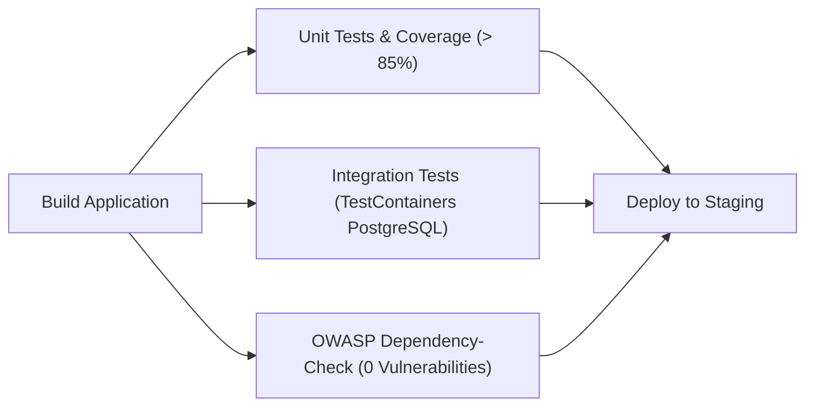

# Desafio Integrado e Discussão Final

Arquivo do pipeline: `.github/workflows/integrated-pipeline.yml`.

## 1. Arquitetura do Desafio Integrado

1. **Execução Paralela (`needs: build`):**
   - `unit-tests`: executa testes unitários JUnit 5, Checkstyle, PMD e exige cobertura JaCoCo estritamente acima de 85% (`-Djacoco.minimum.coverage=0.86`, sendo a cobertura real em `main` de **93,10% de linhas** e **100% de branches**).
   - `integration-tests`: executa `mvn -B verify -Pintegration-tests` subindo um container real `postgres:16-alpine` via **TestContainers** (`AuditoriaNotificacaoPostgresIT`) para validar DDL, inserção parametrizada e leitura JDBC.
   - `owasp-security-check`: executa **OWASP Dependency-Check** (`dependency-check/Dependency-Check_Action@main`) com `--failOnCVSS 0.1`, garantindo ausência de vulnerabilidades conhecidas antes do deploy.
2. **Condição Estrita de Deploy:**
   - O job `deploy` possui `needs: [unit-tests, integration-tests, owasp-security-check]`. Se qualquer um dos três falhar, o deploy é automaticamente cancelado/bloqueado.

## 2. Discussão: GitHub Actions vs Jenkins — Qual abordagem é melhor para o projeto?

Para este projeto Java/Maven hospedado diretamente no GitHub, o **GitHub Actions** é a abordagem mais vantajosa pelos seguintes motivos:

1. **Zero custo operacional de infraestrutura:** runners `ubuntu-latest` já trazem Docker pré-instalado (essencial para executar **TestContainers** e **OWASP Dependency-Check** sem configurar agentes DinD próprios).
2. **Integração nativa com Pull Requests e Environments:** status checks obrigatórios, artefatos (relatórios JaCoCo/OWASP) e regras de aprovação manual em `environment: staging` funcionam nativamente na própria interface do repositório.
3. **Configuração declarativa versionada:** arquivos YAML em `.github/workflows/` evoluem junto com cada branch e PR.

Por outro lado, o **Jenkins** (`Jenkinsfile` em Groovy) permanece excelente em cenários corporativos *on-premises* onde o código precisa acessar clusters Kubernetes privados internos, redes isoladas sem exposição à nuvem pública ou orquestrações híbridas multiplataforma. Manter ambos (`ci.yml` / `integrated-pipeline.yml` e `Jenkinsfile`) demonstra portabilidade completa da automação de qualidade baseada em Maven.
